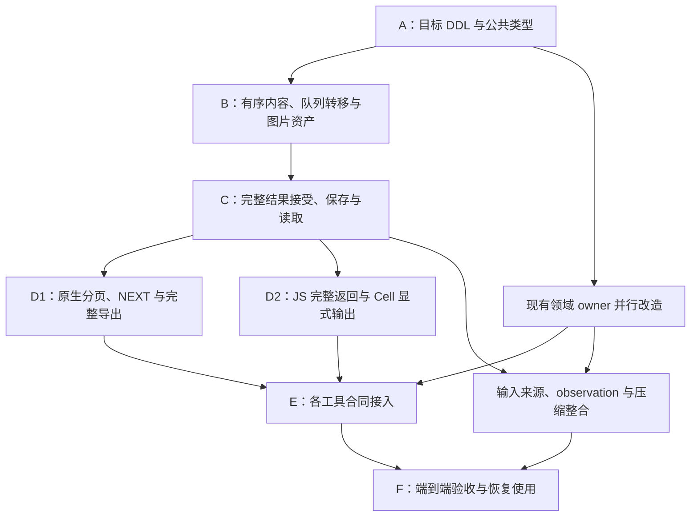

# Pulsara Hardcut 实施计划

日期：2026-11-16。

状态：A、B、C、D、E、F 批次已完成实施与验收，三位 Astra 最终审阅确认的 8 项问题已修复并交叉复验。按用户授权，当前构建已覆盖安装并重新启用，本机生产专用数据库已按当前 clean-v0 重建，旧 App 未保留，11 组模型配置保留。本轮未 stage／commit，不恢复实施前会话，不保留兼容路径。实际范围、命令、完整日志及保留的失败记录见 [D／E／F 验收报告](output/hardcut-20261116/coordinator/DEF_REPORT.md)、[最终修复验收](output/hardcut-20261116/final-fixes/REPORT.md)与[部署记录](output/hardcut-20261116/deployment/REPORT.md)。

| 完成批次 | 实际接通范围 |
| --- | --- |
| A | clean-v0、权限与约束、共同内容／结果类型、DATA codec、Plan 唯一结果、记忆规范化与长度约束 |
| B | 用户／助手／调用／队列／结果共同内容、消费／steer 原子转移、Agent 材料分组、Cell 来源与 fork 自包含、独立图片资产与 GC |
| C | 完整业务值接受／保存／读取、精确确认与未知提交结算、内部事实、Plan 阻塞审批和唯一续接 |
| D1 | 原生 12k 冻结分页、read_file NEXT、完整结果导出、真实输入安装与失败投影 |
| D2 | JS 完整业务值、真实 err.result、Cell 显式递归图文、Agent／Decision、实际资源实验 |
| E | native_tools 全工具族、记忆 CRUD／混合召回、MCP meta-only／搜索／资源、Plan／定时任务、Runtime／Hook／压缩、前端与 bundled Skills |
| F | 当前全部 Python 模块、前端／桌面、真实双协议 DeepSeek、SDK 先读后写脚本、前缀及图片 payload、构建与跨域复审 |

当前 Python 401 个模块均有最新成功记录：5,784 项通过、20 项原有平台跳过；最终修复后重跑 61 个共享模块、959 项通过。前端 102 个模块／1,619 项通过，桌面 150 项通过。保存的 DeepSeek deepseek-flash Chat Completions 与 Responses 在修复后均完成原生 NEXT、完整 JS、安装的 SDK 参考读取及现场脚本组合、图片、Agent 依赖、跨 Cell MCP 引用、压缩及后续 turn，分别完成 25／28 次真实请求前缀比较；此前的记忆增查改删双协议实测仍有效。失败尝试原样保留，不用模型文字自述代替真实返回值或图片字节验证。

默认提示词沿旧结构删改，ROOT 与 Subagent 篇幅均缩短。23 个 JS API 的参数和完整返回声明仅在 bundled Code Mode Skill 的按需参考中提供，由实际参数与业务 owner 生成，不向原生工具描述／参数 schema 添加返回声明，不新增运行时已读门槛或输出校验器。

MCP 初始服务目录增量按[实施规范](PULSARA_MCP_CATALOG_INCREMENTAL_IMPLEMENTATION_SPEC.zh.md)接入 collector／compiler／continuity，保留固定 native tools、按需查询及 meta 调用。该增量的测试与双协议真实 DeepSeek 记录见[报告](output/hardcut-20261116/mcp-catalog/REPORT.md)；本增量不构建、安装或操作运行中的应用，不修改生产配置或生产数据库。 本增量最终 205 项相关测试通过、无跳过；保存的 DeepSeek 两协议完成 19 次真实请求、6 次 SDK MCP 调用和 13 对同 epoch 前缀核验，冷／压缩目录及引用复用均通过。

## 1. 实施依据与范围

本计划组织现有合同的实施依赖、并行分工和验收，不重新定义产品语义。以用户最新明确决定、根目录现行草案及 `native_tools/` 下已确定的合同为准，现行代码用于定位需要替换或复用的接点，历史文档和实验草稿不构成另一套合同。

共同基础及独立业务修订：

| 文档 | 负责的合同 |
| --- | --- |
| [有序内容数据库 hardcut](PULSARA_ENTRY_READABLE_CONTENT_STORAGE_HARD_CUT_DRAFT.zh.md) | 唯一正文、内容类型、队列归属转移、图片资产、业务字段与内部事实、存储消费者及停用实施 |
| [统一结果交付与分页 hardcut](PULSARA_UNIFIED_TOOL_RESULT_DELIVERY_AND_PAGINATION_HARD_CUT_DRAFT.zh.md) | 完整接受与保存、原生 12k／NEXT、完整导出、JS 全值、Cell 显式图文输出、真实失败和资源边界 |
| [记忆 CRUD hardcut](PULSARA_MEMORY_CRUD_HARD_CUT_DRAFT.zh.md) | 新记忆对象、CRUD、并发、检索、回答偏好及混合隐式召回 |
| [MCP 初始服务目录](PULSARA_MCP_CATALOG_INCREMENTAL_IMPLEMENTATION_SPEC.zh.md) | 新上下文轻量名称目录、同次冻结比较点、未知恢复与发现指引 |
| [MCP meta-only 架构](PULSARA_MCP_META_ONLY_CALLING_ARCHITECTURE_DRAFT.zh.md) | 删除 MCP direct、当前目录、session 共用引用、权限、刷新和执行结算 |
| [Runtime Observation 修订](PULSARA_RUNTIME_OBSERVATION_REVISION_DRAFT.zh.md) | source／body 数组、三个发送入口、能力净变化、记忆增量及压缩恢复 |
| [Hook 独立消息修订](PULSARA_HOOK_CONTEXT_MESSAGE_REVISION_DRAFT.zh.md) | pulsara_hook_context、事件放置、后台文字、输入候选隔离及现有控制语义 |
| [原生工具合同索引](PULSARA_NATIVE_TOOL_CONTRACTS_AND_TUTORIAL_DRAFT.zh.md)与 [native_tools/](native_tools/) | 各工具参数、返回类型、原生／JS 边界、业务范围、状态及使用示例 |

具体工具以相应分篇的已定合同为准。例如 MCP 关键词搜索按最新 [capabilities.md](native_tools/capabilities.md)接入；根目录架构中的三层精确查询示例不构成额外精确查询门槛。

[Motion 产品语义草案](PULSARA_MOTION_PRODUCT_SEMANTICS_DRAFT.zh.md)中明确延后的画布、采样等修订不纳入本次实施。多媒体及 unified 已确定的现行 motion 完整范围生产、保存和冻结分页仍须落实，不能一并延后。

若实现中发现合同存在无法同时满足的实质冲突，说明具体输入、两种行为及影响，再讨论修订合同；不得自行用兼容路径、隐藏限制或新机制填补。

## 2. 停用、数据库重置与 hardcut 纪律

1. 实施期间持续停用 Pulsara 的正常产品使用。停止会访问目标数据库的应用、Host、后台调度及旧工作进程，沿现有路径完成必要的在途效果结算；期间只运行受控测试、实验和开发验证。
2. 本次使用的已核实本机开发／测试数据库始终是可丢弃状态，可以无负担地清空、重置并从当前 clean-v0 重建。无需保存、迁移或恢复旧会话、旧记忆或中间测试数据，也无需为同一已确认可丢弃目标的重复重置反复请求许可。
3. 执行清空前仍须核实有效 Pulsara home 和实际数据库目标，避免操作错误数据库。此授权不延伸到未核实的数据库、远程数据库或用户保存的配置与凭据文件。生产配置按仓库规则只读加载，不因清库改写。
4. 允许跨多个工作阶段和提交分步并行推进，允许中间应用不可运行。已被替换的生产路径在对应改造中删除，不保留旧会话兼容、别名、双读双写、旧新格式协商、回退入口或临时恢复使用路径。
5. 不建设线上迁移链，不为本次停用新增数据库维护状态、版本开关、持久迁移任务或恢复系统。结构变化更新 clean-v0，需要时直接再次重建已核实的可丢弃数据库。
6. 共享测试数据库的重置由当前协调者安排，避免清掉其他 agent 正在验证的状态。可独立使用临时测试库或独立测试实例；独立实例不成为产品持久机制。不要求为保留实验数据阻止必要重置。
7. 只有第 9 节恢复条件全部满足后才能恢复正常使用。不能以单个工具通过、数据库能存图或应用能启动作为恢复依据，旧二进制不得访问新结构。

hardcut 不改变当前合同会话内的正确性：同一 epoch 的 SYSTEM 和 provider tools 保持字节一致，messages 只按后缀追加；仅新的 cold epoch 或明确采用的 compaction successor 可以重建输入根。不能以实施方便为理由增加重建边界。

## 3. 拓扑依赖与启动条件

主依赖如下。领域 owner 指现有记忆、MCP、进程、Plan、Agent 等模块，不表示新增一层业务框架。



箭头表示接通和验收的必要依赖。下游可以提前读代码、编写局部实现、准备测试和开展独立实验，不必等待上游整个批次完成；其集成验收须使用真实的新 owner 和已完成的依赖，不能靠旧接口适配器宣称接通。

| 节点 | 必要依赖 | 可提前并行的工作 | 合流条件 |
| --- | --- | --- | --- |
| A | 已定文档 | 现有字段、消费者及删除范围核对 | 目标 DDL、公共类型和事务边界一致 |
| B | A | 独立 blob、图片、队列及来源测试准备 | 新结构实际承载共同内容及受控转移 |
| C | B | 各工具业务值和内部事实的映射 | 实际结果只保存一份，可完整组装与读取 |
| D1 | C | 确定性文字、行号和分页算法的局部验证 | 真实保存结果的原生首屏、续读和导出贯通 |
| D2 | C、B 的 Cell 输出入队 | bridge、JS 类型、递归图片输出和资源实验准备 | JS 全值及显式输出沿真实保存／接纳路径交付 |
| 领域 owner | A 的目标接口；各自业务结构 | 记忆 CRUD、MCP 目录／引用、进程暂存及既有控制 owner 改造 | 按各工作包接入 C、D1 或 D2，不扩大入口范围 |
| Runtime 输入整合 | 已明确的输入形状及来源接口；最终依赖 C 和对应领域事实 | source／body、事件位置、发送条件和输入安装结算可提前实施 | 使用真实来源和安装边界，完成 Plan／记忆／能力及压缩验证 |
| E | C、相应交付入口和本工具领域 owner | 各工具参数、校验、生产者与测试可并行 | 每个公开入口均采用完整新合同 |
| F | 必要工作包及其消费者完成 | 持续积累真实集成证据 | 跨层验证通过，替代路径及相关旧消费者已删除 |

首批实际实施限定在 A、B、C 的最小完整基础。最早贯通场景选择长文件结果，再扩展为有序图文结果，避免每个工具各建一套存储或分页实现。

## 4. 各批次工作与验收

### A 批：目标结构与共同代码合同

工作：

- 将 content_parts、blob／图片资产、调用关联、public_fields 与必要 result_facts 的职责落实为具体 DDL 和代码类型。
- 同一 clean-v0 纳入记忆字段与约束修订，以及 Plan 阻塞审批、RUNNING 原轮和唯一最终结果所需的约束变化。由同一存储负责人整合 baseline，不按工具族分别建立迁移链。
- 固定共同内容项、最小 Target、工具正常／失败业务值、原生／JS 边界和结果接受接口。类型从工具定义及业务 owner 取得，不另写与执行脱节的 SDK DTO。
- 明确旧字段的实际消费者和替代位置，特别保留执行、权限、观察及协议回放仍需要的事实；不因名称相似整组删除。

验收：新 clean-v0 能建立；数据库约束能表达 owner、载荷、顺序及受控更新；代码接口覆盖已定工具合同；没有新增正文实体、版本标签、持久引用注册表或其他无独立用途的机制。

### B 批：共同内容、归属转移与图片资产

工作：

- 接通用户、助手文字与工具调用、队列、工具结果和 Cell 输出的共同内容发布／读取，隐藏 inline／blob 的物理差异。
- 在现有事务内完成 queue→entry、排队改 steer 的 queue→实际替代 queue，保留原内容身份、顺序和载荷。正确设置主指令的 initial_entry_id／consumed_entry_id。
- 图片资产独立于 session／workspace，保留有效资产外键；凭已知 IMAGE_REF 读取，不保留来源或队列消费资格检查。
- 同步 fork、删除和 GC，保留必要协议回放及可视化的独立职责。普通正文 blob 的既定归属不随图片独立性一起删除。
- 删除现有 blob 路径中的旧人为 16 MiB 单 blob 上限，验证既有 bytea 能承载完整内容；不建设新分块存储。

验收：内容和原换行完整读回；并发消费不重复，失败完整回滚，没有双 owner 或双份正文；主指令与材料不混合；图片跨会话／工作区复用，坏引用按既定规则处理；fork 不移动父内容，GC 不误删仍被引用的资产；单个超旧上限的 text／object 保持原类型和内容项边界。

### C 批：完整结果接受、保存与读取

工作：

- 由原执行事实、已声明公开字段及共同内容行组装完整业务值。public_fields 不包含另一份 content、原生页或整份返回 JSON；已有状态和时间从原权威事实投影。
- 正常、ERROR、CANCELLED 以及实际存在的失败值共用接受路径。已确定效果、结果保存失败和提交状态不确定分别如实处理，不自动重新执行业务。
- 接通内部事实用途：定时任务配置与 revision 同次冻结，媒体标注文件绑定与成功结果一起接受；不复制配置或标注正文。
- 删除全文／预览双轨、旧序列化正文包和只服务展示裁剪的保存逻辑。保留真实失败和结算消费者，不照搬旧字段组。

验收：缺失／null、JSON 类型、顺序和失败值无损；JS、原生和导出读取同一保存值；修改实时业务对象不改写历史结果；保存或交付失败不伪造可读 Target，不重做副作用；内部执行事实不会进入公开结果或导出。

### D 批：两条交付路径并行贯通

| 工作线 | 工作 | 验收 |
| --- | --- | --- |
| D1 原生 | 确定性文字投影、真实封装计量、12k 顺序装页、图片附件、首屏／续读实际范围、read_file(NEXT)、write_file(tool_result_target) | object 可跨页，图片与独立 Target 不拆；正常首屏和续页指同一原完整结果；NEXT 不执行来源业务、不重查状态、不复制页面正文；导出不受已读页数或模型图像能力影响 |
| D2 JS／Cell | 完整类型化返回、实际 err.result、固定 SDK、bridge 单值旧限制删除、console.log／return 递归图片识别、输出入队 | JS 取得全值且无展示 NEXT；中间值不自动披露；只扫描显式输出；整条移交，图片失败保留其他内容；steer 不产生 read_file 读取／导出入口；停止、异常及晚到结果沿既定语义 |

先贯通长文本：真实保存→原生首屏→NEXT→完整导出，并验证同次业务范围的 JS 全值。再贯通 text→image→object→image，覆盖能力不足、坏引用和分页边界。

两条线共用结果读取和图片 owner，各自实现入口规则。不能用原生页面拼成 JS 值，也不能把 JS 完整返回当作 ROOT 已读。续读失败、实际已接受文字占位和图片物理交付失败按合同分别验证。

### E 批：工具、领域事实及消费者并行合流

按第 5 节工作包分步接入。每个工具完成时，参数、校验、业务生产者、保存、返回、公开目录、SDK／提示词及实际消费者应共同符合当前合同；不只替换最外层包装。

每个工作包的局部验收至少覆盖真实成功、业务失败、取消、效果已发生但后续失败、适用访问范围，以及该工具实际支持的原生／JS 入口。支持分页的结果验证冻结读取，副作用工具验证 NEXT 不重复执行；仅 JS 工具不要求新增原生页面。

工具主体仍负责完成本次业务范围。文件／历史搜索、视频和转录等不能继续把旧业务第一页送入新保存层，再称为完整结果。

### F 批：端到端验收及恢复

依第 9 节完成跨层验证、旧路径删除和必要消费者检查。真实 provider 验证使用新合同会话，读取现有保存配置，不修改配置或引入环境凭据兜底。先做合适范围的验证，只有出现新失败或未解决问题时再扩大或重复。

## 5. 并行工作包及内部顺序

以下是职责划分，不要求固定 agent 数量，也不新增任务数量或寿命限制。按可用并发安排；公共接点由第 6 节指定的负责人集中整合。

| 工作包 | 依据 | 接入前的必要基础 | 内部顺序及重点验收 |
| --- | --- | --- | --- |
| 文件与终端 | [filesystem](native_tools/filesystem.md)、[terminal](native_tools/terminal.md) | C、相应 D1／D2 | 文件 PATH 与共同投影先行，再 NEXT、导出及完整搜索；进程先改待观察日志暂存，再接三个工具。行号从冻结请求／事实及正文推导；日志保存成功后才推进内部位置，状态随结果冻结；进程保持 session 隔离 |
| 多媒体 | [media](native_tools/media.md) | 图片资产、C、相应 D1／D2 | 先 view_image，再视频三 action 和完整转录；删除全部旧 ASR 180 秒及展示装页导致的提前返回；annotate_media 可并行接内部绑定和前端。图文有序、JS 全值、坏图占位、完整转录、标注 NEXT 无副作用 |
| 记忆与历史 | [memory](native_tools/memory.md)、[session_history](native_tools/session_history.md)、根目录记忆草案 | 记忆目标结构、C；历史依赖共同正文和 QA 投影 | CRUD／索引／用户页面可先做；历史先统一正文与 QA／QAQ，再接三个历史工具；隐式混合召回在两种来源均可用后合流。title／kind 固定、偏好正文为空、范围与并发准确；历史不误纳工具及思考；8 条偏好、20→5 召回及增量结算正确 |
| 能力与 MCP | [capabilities](native_tools/capabilities.md)、[manage_capability](native_tools/manage_capability.md)、[mcp](native_tools/mcp.md)、根目录 MCP 架构 | 公共 Target、当前目录与引用 owner；完整结果及图片路径 | 本地来源与管理包装可先做；MCP 先删除 direct 并接当前目录、session 共用 REF，再接详情、调用及资源，最后 bm25s 搜索。搜索复用完整 schema／REF，描述摘录保存后冻结；管理复用安装、启停、信任、凭据和结算；只使实际受影响的引用失效 |
| Agent、Code Mode 与判断 | [agents](native_tools/agents.md)、[code_mode](native_tools/code_mode.md)、[decide](native_tools/decide.md) | 队列／材料转移、C；JS 工具及输出依赖 D2 | 原生查询／消息／控制可先接；run_agent 的材料冻结与消费归属合流；wait_agent 保留 WORK／AGENT 两分支及 Cell 内通知位置；控制工具只改参数与结果，保持 stop 及晚到语义；decide 复用现有执行路径。完整结果、消息独立交付、依赖就绪及取消分别验收 |
| Plan 与定时任务 | [plan](native_tools/plan.md)、[schedules](native_tools/schedules.md) | 相应 DDL、C、队列与 turn 边界 | 两者可独立推进。Plan 先唯一最终结算，再十分钟等待、Markdown、前端和自动续接；修订／取消／超时继续同一只读 turn。定时任务先冻结查询和内部 revision，再六 action；时间规则、用户页面修改、排队取消与运行中回复均按合同 |
| 简单原生工具 | [todo](native_tools/todo.md)、[open_in_pulsara](native_tools/open_in_pulsara.md) | C、D1 | 适合作为早期工具接入样板。todo 10 项及状态计数；展示逐项接受、部分失败 ERROR、已发生效果准确。前端使用内部事实，不依赖被删除的公开字段 |
| 输入、Hook 与交接 | 根目录 Runtime、Hook、记忆及 Plan 草案 | 公共输入形状；最终依赖真实领域事实、C 及输入安装边界 | 公共外壳／入口可先做，按第 7 节逐项合流；不得把全部 observation 塞到每次请求，也不得让 Hook 等待用户消息 |

依赖区别：

- MCP 搜索依赖当前目录、详情构造和引用 owner，不反向决定 meta-only 架构；完整 schema 和 REF 随命中工具一起返回，不强制再精确查询。
- 记忆 CRUD 不等待三个历史工具的公开包装；隐式混合召回等待的是共同历史 QA 投影和检索资格。
- 定时任务与记忆各自保留并发事实及事务；实现理念相似不构成两者代码先后依赖，不建设通用持久快照系统。
- Plan 自动写出 Markdown 复用内部文件能力，不依赖公开 write_file 工具先完成，也不扩大规划期的一般写权限。
- Agent 材料冻结、依赖就绪和消费顺序落在 Work／队列 owner，不用工具包装补出第二份材料正文。
- Code Mode 和 Agent 的原生控制结果不等于异步输出正文；结果包装不能吞掉、重复或撤回独立 steer／消息。

## 6. 公共文件分工与集成

为公共接点指定明确负责人；同一负责人可以随阶段交接，但交接时须说明已完成接口、未完成消费者和当前测试状态。

| 公共接点 | 集中负责范围 | 其他 agent 的协作方式 |
| --- | --- | --- |
| 存储与结果 | clean-v0、共同内容 repository、blob／图片、结果接受事务及完整读取 | 各领域给出实际字段、内部事实和事务需求，负责人统一落到现有 owner；不各建正文或状态副本 |
| 模型输入与工具公开定义 | builtin_catalog、公共 schema／SDK 生成、provider 编译／安装、compaction | 各工具完成自己的类型、生产者和用例，公开定义及输入拼接集中整合，避免多个工作包反复改同一分支 |
| Code Mode bridge 与输出 | Python／Node／guest 边界、固定 API、完整返回和显式图文输出 | 各业务包使用相同返回合同，不自行加 JS 分页、emit 或独立错误包装 |
| 前端及接口的共同接点 | 共享 DTO、路由、展示与会话输入接续 | 各工作包同步自己的页面／消费者，共同接点由指定负责人合流；用户级页面不依赖活动会话 |

特别避免多个 agent 同时独立重写 baseline、builtin_catalog、tool_runtime、结果接受事务和输入 compiler。使用普通协作和 Git 分步提交协调，不为协作新增生产注册表、完成回执或持久任务机制。

已完成的 PreToolUse 改参删除、Hook 输入候选隔离、同批 slash 收集及旧 Skill 激活数量限制删除，作为当前基础保留并做相关回归，不重复设计。原生安装的公共能力、精确 provider 回放、权限和副作用结算保留其独立职责；删除 MCP direct 只处理其专属路径。

## 7. Runtime、Hook 与压缩的合流验收

| 部分 | 接通时机及条件 | 必须证明的行为 |
| --- | --- | --- |
| 公共 observation | 输入形状和安装接口明确后可先实施 | 仅 source／body 数组，text＋可选 target；所有新 turn、用户主动 steer、活动 turn 压缩恢复三入口，各 source 仍按自身条件发送 |
| Skill | 能力来源事实、实际文件读取与 compaction 接通后 | 初始／压缩后完整目录，平时净变化；slash 只给优先 read_file 提示；合法 read_file 读取过且仍有效的技能在 TODO／PCA 旁强制重读，不贴全文；正文单独变化不新增通知 |
| MCP | 当前已接纳目录和相关事实可用后 | 最新净 diff 临时计算；输入安装成功后用生成通知的状态快照替换旧快照；ABA 不通知；不用展示摘要判重，不在普通工具续跑发通知；已停用工具的即时调用准入不等待通知 |
| 记忆 | 新对象、共同 QA 检索及输入安装可用后 | 只随新采用的 ROOT 真人消息／主动 steer；偏好追加或全量替换、召回新版本及失效通知一致；必要读取失败整条说明不可用，不推进 P／i；普通续跑和压缩不额外检索 |
| Plan | 实际工作流、turn 关联和参数原文可读后 | 新 turn 的 TURN_CONTEXT；规划压缩的 PLAN_MODE 引用进入规划前 turn A 最后一条已交付用户输入；执行续接与压缩携完整 APPROVED_PLAN；不从 Markdown 或摘要取代原文 |
| 前轮与用户操作 | 现有中断、工具结算及控制事实接通后 | 前轮说明简短且不改写调用闭合／迟到结果；USER_ACTIONS 只报工作区重建和进程控制，按规定入口取出，压缩不重放 |
| Hook | 现有输出 owner 和消息追加接通后 | pulsara_hook_context 按事件交付；删除旧 HOOK_CONTEXT source，无空消息、无启停通知；阻止、权限裁决及续接保持；未采用输入不泄漏，后台晚到尽力交付、不唤醒、不回插历史 |
| 活动／空闲压缩 | 上述事实及新上下文安装接通后 | 活动压缩恢复 TODO／PCA、待读 Skill 和适用 observation，即使 TODO／PCA 为空也恢复运行说明；空闲压缩不提前注入 Runtime 交接或旧执行要求；SessionStart(compact) 按既定时机执行 |

所有发送及比较状态只按各自已定接受／安装边界推进，不因候选准备、队列采用或模型回复而另建成功条件。新上下文只能在批准边界重建，同 epoch 输入保持前缀连续性。

## 8. Agent 草稿、待办、实验和测试目录

本轮所有 agent 的工作草稿统一放在仓库根目录的 `output/hardcut-20261116/` 下。每个 agent 开始工作时创建自己的子目录，使用便于辨认的任务名称，例如：

```text
output/hardcut-20261116/
  storage-results/
  native-delivery/
  code-mode-agents/
  files-terminal/
  media/
  memory-history/
  capabilities-mcp/
  plan-schedules/
  runtime-hooks/
```

这些名称是示例，不要求为目录分配对象 ID，也不强制固定 agent 数量。每个实际 agent 使用自己的独立子目录；接手同一工作包时明确目录归属，避免互相覆盖。

各 agent 可以在自己的目录内自由进行与本次 hardcut 有关的实验、编写和更新待办、准备测试输入、运行测试、保存结果及日志、编写草稿和复审意见。可自行选择文件名和组织方式，必要时用一份简短待办说明已完成、下一步、依赖及实际失败，不新增强制报告 schema 或审计流程。

目录中的实验代码、脚本和测试用于验证；正式实现、维护用测试和当前产品文档仍落在仓库对应位置。有效结论需要体现在正式代码／测试或现行文档中，output 草稿不自动升级为合同，也不能成为生产代码的兼容入口、依赖或永久权威。

使用仓库根 `.venv/` 和既有 uv 环境运行本地 Python 命令与测试。复用 SDK、库和现有 owner，不复制协议、存储或调度框架来做生产替代。真实配置只读，日志保留有用输入、输出和失败详情，排除实际凭据值；不为实验覆写用户保存配置。

实际目录由执行相应任务的 agent 创建。协调者在自己的子目录汇总本批实现、测试命令、实际失败及未完成消费者，不以草稿替代正式合同或维护用测试。

## 9. 验证、资源实验与恢复条件

### 9.1 分批验证

各批次使用当前合同的聚焦测试和相应数据库验证。删除只锁定被替代结构的专属测试，保留真实权限、顺序、并发、结算和前缀行为；不靠弱化断言、skip／xfail 或改写证据取得通过。

已有消费者尚未接通时如实记录缺口，不能为让旧测试或旧应用运行而添回兼容路径。局部测试不意味着整个产品可用，受控验证期间继续保持正常使用关闭。

### 9.2 资源实验与当前取值

当前已完成以下真实实验与接线：

- 既有 bytea 承载完整大内容，使用现有 inline／blob 放置机制，不新增分块存储或恢复旧单 blob 总量上限。
- Code Mode 当前物理 profile 为每 Cell 32 MiB、Host 合计 128 MiB 在途数据；保留四个活动 QuickJS VM 各 64 MiB heap。源码、参数、完整结果、并发输出和约 18 MiB 有效 PNG 均经实际 owner 验证；额度覆盖同时占用，不限制累计输出、历史、调用数或脚本寿命。
- 终端约 40 MiB 日志经内存／临时文件暂存及接受位置验证，不恢复总日志淘汰；保存结果后的续读不重做业务。
- MCP 搜索先用完整名称／描述评分，再取首处命中前最多 120 字符起、通常 400 字符窗口的原文摘录；不截断参数 schema 或完整结果，不以原生页长决定摘录。

详细过程及真实失败见各领域报告。资源失败仍如实报告，不截断成功值、伪造保存、重做业务或自动给 Cell 输出分页；没有新增总历史、总调用或总寿命 cap。

### 9.3 恢复使用的必要条件

| 验证组 | 恢复前必须完成 |
| --- | --- |
| 数据库存储及事务 | 共同内容完整性、队列转移与回滚、Plan 审批约束、记忆修改与删除并发、定时任务内部 revision、图片 fork／GC |
| 结果及交付 | 长文本、object 跨页、交错多图、坏图／能力不足、失败结果、原生 NEXT、完整导出、JS 全值及显式 Cell 输出；冻结结果不受实时状态变化影响 |
| 业务范围 | 文件及历史完整查询、视频完整请求、超过旧限制的完整转录、MCP 内容与资源适配、搜索结果 schema／引用、记忆检索与偏好 |
| 生命周期及效果 | Plan 十分钟唯一结算与三 turn 续接、Agent 依赖与材料消费、消息交付、Cell／Work 停止、已提交工具调用、迟到结果、审批与取消竞争；补页不重复副作用 |
| 模型输入与压缩 | 三个 observation 入口、安装后快照结算、记忆 P／i、Hook 事件位置、活动／空闲压缩、完整获批计划与 Skill 重读；无前缀改写 |
| 前端与其他消费者 | 队列／草稿到 entry、展开复制、图片及批注、历史与索引、记忆页面、Plan 交互、定时任务及能力页面；用户级页面保持独立于活动会话 |
| 真实 provider | 使用新合同会话验证实际文字及图片投递、工具调用与结果闭合、原生／JS 路径、权限及 compaction；相关 Chat Completions／Responses 适配符合合同，SYSTEM／tools 与 messages 前缀连续性成立 |
| 单一路径与文档 | 本次替代的旧生产入口、载荷、展示分页、MCP direct、关系记忆及旧 source 已随相应改造删除；固定 SDK、提示词、bundled 教程、当前测试和现行文档描述同一合同，无旧兼容路径 |

恢复前由协调者按工作包明确完成范围、测试证据和仍缺消费者。所有必要链路完成后，使用当前 clean-v0 和当前二进制恢复正常使用；不保留或恢复实施前会话，不为临时可用牺牲单一路径。

MCP 首请求不等待后台连接或发现；删除专属等待状态及 UI，保留配置采用 safe point 和用户级能力页。搜索按当前配置、scope／parent 的已接纳目录判断完整性，未知范围返回 ERROR 并保留可用命中及引用，遵循 [非阻塞启动合同](PULSARA_MCP_NONBLOCKING_STARTUP_IMPLEMENTATION_SPEC.zh.md)。
