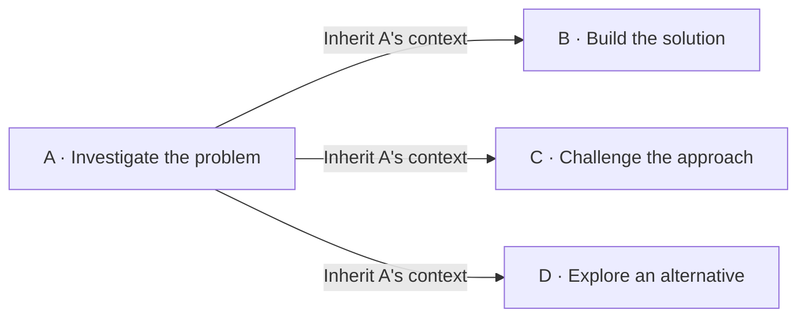

<h1 align="center">
  
  Pulsara
</h1>

<p align="center">
  <strong>A whole team of agents. Your models. Your machine.</strong>
</p>

<p align="center">
  
</p>

<p align="center">
  <a href="#open-the-workbench">Open the workbench</a> ·
  <a href="#built-for-the-whole-job">Explore</a> ·
  <a href="#put-a-team-on-it">Agent teams</a> ·
  <a href="#deliver-something-you-can-use">Artifacts</a> ·
  <a href="#make-it-your-own">Ecosystem</a> ·
  <a href="README.zh-CN.md">简体中文</a>
</p>

**Pulsara puts a personal AI team to work on your code, research, and data.** Give it an assignment: investigate a bug, compare competing approaches, turn a dataset into a dashboard, or prepare a document for review. It plans the work, delegates tasks, runs tools, and builds the deliverables in a local-first visual workbench.

Agents can work in parallel, branch from a shared investigation, and carry knowledge into future conversations. Stable prompt prefixes give long runs a foundation for cache reuse. Follow the work in the desktop workbench, steer it as it develops, and open the code, documents, or interactive results it produces.

**Bring an ambitious task. Give Pulsara room to work.**

## Built for the whole job

| Capability | What it brings to your work |
| --- | --- |
| **Parallel agent teams** | Put investigation, implementation, and review on separate agents, each with its own context and model. |
| **Branchable context** | Take several approaches from the same completed investigation, carrying its conversation and tool history into each branch. |
| **Persistent memory** | Bring your preferences, project knowledge, and earlier decisions into the next assignment. |
| **Long-running work** | Keep moving through lengthy investigations with context compaction, background terminals, and saved conversations. |
| **Prompt-cache reuse** | Keep exact prefixes stable so supported providers can reuse processed input, lowering input cost and response latency on cache hits. |
| **Useful deliverables** | Get working code, interactive dashboards, Word documents, editable spreadsheets, PDFs, and diagrams. |
| **Skills, MCP, and plugins** | Give agents the specialist workflows, external services, and project tools your assignment calls for. |
| **A visual control room** | Inspect task conversations and tool activity, review plans, and steer the work while it runs. |
| **Your choice of models** | Mix OpenAI-compatible providers and self-hosted endpoints, choosing a model and reasoning level for each job. |

## Put a team on it

Let one agent trace the implementation while another checks the assumptions and a third explores the data. Pulsara's coordinating agent delegates the assignments, gathers the findings, and turns them into the next step.

Each task has its own conversation and progress. Open the task graph to see the work unfold, read a worker's findings, or inspect its inherited context. Agents can arrange tasks in stages and pass results into later assignments.

### One investigation. Multiple paths forward.

A good investigation is worth building on. Pulsara can continue its conversation and tool history in a new task—or use it as the common starting point for several branches.



The implementation agent starts with the investigation in hand. The reviewer starts from the same findings and develops an independent continuation. Another agent can explore an alternative. Each branch builds its own history while working with the project files in your shared directory.

Use a fast model for a focused check and a stronger model for a difficult design problem. Give a reviewer a second look at the result. You can inspect every task's conversation as the team works.

## Keep the work moving

Take on the refactor that needs several passes, the investigation that keeps uncovering new questions, or the project you'll return to tomorrow.

Pulsara searches files, edits code, runs commands, and checks their output. Leave a long-running command in a background terminal while the agent takes another step. Context compaction makes room as the conversation grows, and saved history keeps the work available when you return.

Send a correction while the agent works, queue the next instruction, or stop to reconsider. Plan mode lets it investigate and propose an approach for your review before implementation begins.

## Built for prompt-cache reuse

**Long context is an investment. Pulsara keeps it ready for reuse.**

As agents work through successive steps in the same context, system instructions and tool definitions stay byte-identical. New messages, tool results, and user guidance append to the history, preserving the exact prefix established by earlier calls. After compaction, the fresh context follows the same discipline.

That continuity gives [provider prompt caching](https://developers.openai.com/api/docs/guides/prompt-caching) a stable foundation for repeated hits. Cached prefixes can reduce input-processing cost and speed up response starts. The more steps share a growing history, the more previously processed context remains available for reuse.

Input budgets use the latest compatible provider-reported input count plus an estimate of the appended request content. Missing usage keeps the previous compatible anchor; without an anchor, the existing heuristic applies. Response usage remains queryable after reopening a conversation, while a fresh context starts with a fresh estimate. See the [usage and input-budget contract](archived_docs/PULSARA_PROVIDER_USAGE_ANCHORED_INPUT_BUDGET_HARD_CUT_IMPLEMENTATION_SPEC.zh.md).

The ring beside the model selector shows estimated context use; hover to inspect the count and available input budget. Switching models recalculates the estimate. At the compaction threshold, the ring turns red. Unsent content is excluded. See the [context indicator contract](archived_docs/PULSARA_CONTEXT_USAGE_INDICATOR_IMPLEMENTATION_SPEC.zh.md).

Catalog models let you set a context allowance from 256,000 tokens to the models.dev maximum. The default uses that maximum. This adjusts input admission and compaction thresholds while preserving provider output ceilings. See the [context allowance contract](archived_docs/PULSARA_MODEL_CONTEXT_ALLOWANCE_IMPLEMENTATION_SPEC.zh.md).

## Knowledge that carries forward

Start the next assignment with your preferences, project decisions, and recurring constraints already available.

Pulsara can remember your writing style, retain the reasoning behind a project decision, and retrieve knowledge from earlier conversations. Keyword and semantic search help the agent find what matters for the current task. Related memories connect the pieces, and newer decisions can supersede older ones.

Open the memory workspace to inspect what's stored, check available sources, edit a preference, or remove something that no longer applies. Your working relationship with the agent gains a history you can see and shape.

## Deliver something you can use

Open an interactive dashboard and explore the findings. Hand an editable workbook to a colleague. Review a Word document with comments and tracked changes. Run the fix against your project.

Pulsara brings those results into the workbench with inline interactive HTML, diagrams, mathematical notation, images, and file previews. Open a referenced file, inspect the full tool output, or export an artifact to take it into your next workflow.

Built-in Skills give agents practical workflows for substantial deliverables:

| Work | Built-in Skill |
| --- | --- |
| **Documents** | [pulsara-docs](src/pulsara_agent/bundled_skills/pulsara-docs/SKILL.md) — Create and edit Word documents, work with templates, comments, and tracked changes. |
| **Spreadsheets** | [pulsara-sheets](src/pulsara_agent/bundled_skills/pulsara-sheets/SKILL.md) — Transform data, build formulas, format workbooks, and produce editable charts. |
| **PDFs** | [pulsara-pdf](src/pulsara_agent/bundled_skills/pulsara-pdf/SKILL.md) — Read, extract, and create PDF documents. |
| **Data analysis** | [pulsara-data-analysis](src/pulsara_agent/bundled_skills/pulsara-data-analysis/SKILL.md) — Explore datasets, run Python and SQL analysis, and build interactive HTML reports. |

### Give it a real assignment

> **Engineering:** “Trace this bug, compare two fixes, have another agent review the chosen approach, and run the relevant tests.”

> **Research:** “Use the connected research tools to compare these approaches. Follow the sources, challenge the assumptions, and build a visual briefing.”

> **Analysis:** “Investigate these spreadsheets, explain what changed, and give me an interactive dashboard plus an editable workbook.”

> **Documents:** “Read these materials, draft a proposal in Word, and revise it around my comments.”

## Make it your own

Settings → Archived sessions includes “Delete all”. Confirmation covers every page of the current list; sessions restored before their deletion check are skipped. A bottom-right notification shows progress and unread results across navigation; it disappears once the final results have been viewed. Incomplete items can be retried from the results dialog. Saved memories and working directories are preserved. Reloading the workbench or quitting the application stops sending remaining items; deletions already accepted by the service still settle.

Bring your research services, specialist workflows, and project tools into the same workbench.

- **Skills** teach agents a repeatable way to handle specialist work. Install one for a new domain or ask the agent to create one for a recurring assignment.
- **MCP** puts external tools, data sources, resources, and prompts within the agent's reach. Configure connections and authentication in the workbench.
- **Plugins** bring related Skills, MCP services, and hooks together in a package.

MCP catalogs follow change notifications supported by the server. Changing a connection target requires confirmation before retaining existing credentials, including credentials embedded in templates; explicitly supplied replacements are evaluated as replacements. MCP schema validation uses only resources within the schema document and reports evaluation failures locally. Application errors, server protocol errors, and transport failures remain distinct, and structured results preserve explicit null values. Connection shutdown and disconnect handling follow the [MCP correctness specification](PULSARA_MCP_CHAIN_CORRECTNESS_HARD_CUT_IMPLEMENTATION.zh.md).
- **Hooks** attach configured actions to supported moments in the agent lifecycle.

Keep capabilities available across your work or scope them to a project. Manage them in the interface, or ask the agent to inspect and configure them. Built-in installer Skills guide the agent through adding Skills, MCP servers, and plugins.

In the composer, type `/` to select a Skill for your message, or `@` to reference a file or directory.

## Choose the right model for the job

Choose a model for a quick lookup, another for a complex implementation, and a third for independent review. Each delegated task can use its own model and reasoning settings.

Connect OpenAI-compatible services and self-hosted endpoints through Chat Completions or Responses. Model selection and supported reasoning controls are available in the workbench, so you can shape the team's mix around the assignment.

Your workbench, conversation history, and memory live on your machine. You choose the model connections that power the work.

## Stay close to the work

Your control room brings conversations, agents, capabilities, memory, and terminals into view. Find a conversation by directory or search its history. Expand tool activity, open a worker's conversation, and watch background commands progress.

Select part of a response to give precise feedback. Fork a conversation to explore a different direction. Review a plan or answer the agent's questions before it takes the next step. When the goal changes, steer the run or stop it.

**Delegate the work. Stay involved where it matters.**

## Open the workbench

Open the installed **Pulsara** desktop application. The app starts its bundled PostgreSQL instance and Python runtime, then opens the workbench. Choose a working directory and configure your models in Settings. Python, PostgreSQL, its search/vector extensions, ripgrep, and the screenshot browser are included in the desktop resources.

The desktop targets macOS 15+ ARM64 and Ubuntu 24.04 x86_64/ARM64. These are build targets; backend CI does not by itself establish desktop installation acceptance on every target. See the [desktop implementation and acceptance plan](PULSARA_DESKTOP_MIGRATION_AND_BUNDLED_POSTGRESQL_PLAN.zh.md) for the current validation scope.

Closing the window keeps the application available in the Dock or tray. Use **Pulsara → Quit Pulsara** for a full shutdown; the app settles current work before stopping its database. On Linux without a tray, closing the window offers minimize or quit.

Application data lives under `~/.pulsara` by default. An absolute `PULSARA_HOME` selects another home. Model credentials remain in the existing local settings; the app owns its database under `desktop/postgres`. The first desktop launch creates its own database and does not import old development history. Ordinary restarts preserve data. During development, incompatible updates can require the explicitly confirmed **Reset dedicated database** operation, which clears conversations, memories, and scheduled tasks while preserving workspace files and model settings.

### Optional command-line tools

The CLI is bundled with the app. macOS and AppImage register `~/.local/bin/pulsara` on first launch and refresh their own launcher on subsequent starts; deb packages manage `/usr/bin/pulsara`. Open **Settings → General → Local services → Command-line entry** to inspect, recheck, or repair it. Existing commands are preserved until you explicitly choose Reset to point the entry to the desktop version. Pulsara does not edit shell profiles: add the entry directory to your terminal PATH if needed and check `command -v pulsara`. AppImage launchers reference the original AppImage file; reopen the app after moving it to update the entry. Commands use bundled Python without a separate installation.

```bash
pulsara app
pulsara --help
pulsara config-check
pulsara db status
pulsara db verify
```

`pulsara app` launches or focuses the same desktop instance and returns after handing off the request. Closing that terminal does not stop the app. `skills`, `plugins`, `mcp`, and `hooks` retain their management commands. Database diagnostics query the running app's private instance; they report unavailable when the app is closed. The public CLI has no Web-server options, external-DSN configuration, or `db migrate` command. Runtime permission/Skill overrides are not accepted by the desktop launcher; configure the corresponding session and capability controls in the workbench.

### Build the desktop from source

Build on the target platform using Node.js 22.13+, npm, `uv` with managed Python 3.12, a C compiler, `make`, `pkg-config`, Bison, and Flex. macOS builds need Xcode command-line tools and `dylibbundler`; Ubuntu builds need `binutils`, `pax-utils` (`lddtree`), `patchelf`, and `libopenblas0`. These are build-machine requirements.

The resource builder builds PostgreSQL **17.9** and **pgvector 0.8.1** from pinned upstream source archives, downloads the pinned **pg_search 0.26.1** package for macOS ARM64 Sequoia or Ubuntu Noble PG17 x86_64/ARM64, verifies downloads, and bundles their native dependencies. It also packages a relocatable Python runtime and Playwright Chromium. Building macOS resources therefore requires macOS 15 or newer. To supply your own matching extension payload instead, pass both `--extension-lib` (native libraries) and `--extension-share` (control/SQL files); the same version and architecture checks apply.

From the repository root:

```bash
uv sync --frozen --managed-python --no-install-project
.venv/bin/python tools/prepare_ripgrep.py
uv sync --frozen --managed-python
npm --prefix frontend ci
npm --prefix frontend run build:desktop
npm --prefix desktop ci
.venv/bin/python desktop/scripts/prepare_resources.py
npm --prefix desktop run package:dir
```

The unpacked application is written under `desktop/release`. `npm --prefix desktop run package` produces the configured DMG or Linux AppImage/deb artifacts. Release signing and notarization require separate release configuration; the local build is unsigned. Re-run the resource builder after Python changes, and rebuild the frontend before refreshing resources after UI changes. `npm --prefix desktop start` runs the Electron development shell against prepared bundled resources; it does not expose a second browser-based product entry.

Backend checks use the repository environment; desktop shell checks use Node's test runner:

```bash
.venv/bin/python -m pytest -m 'not postgres'
npm --prefix frontend test
npm --prefix desktop test
```

Database integration fixtures and Ubuntu package checks are described in [tests/linux/README.md](tests/linux/README.md). Actual desktop acceptance also checks native resources, shutdown, restart, and real model work as specified in the desktop plan.

---

Built with a typed Python runtime, a React workbench, PostgreSQL-backed history and memory, and ripgrep-powered file search.

[Share an idea or report an issue](https://github.com/plumliu/pulsara-agent/issues) · [Contribute](https://github.com/plumliu/pulsara-agent/pulls)
