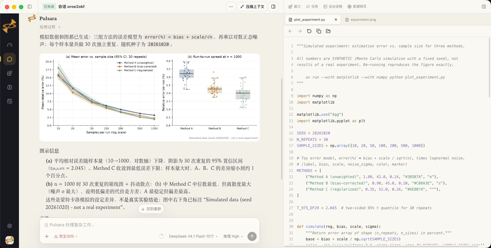
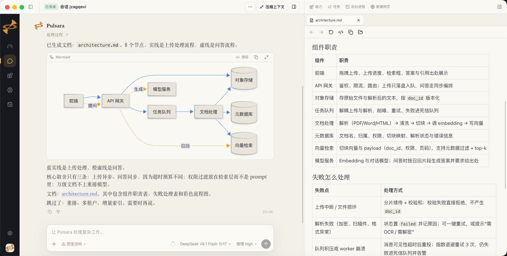
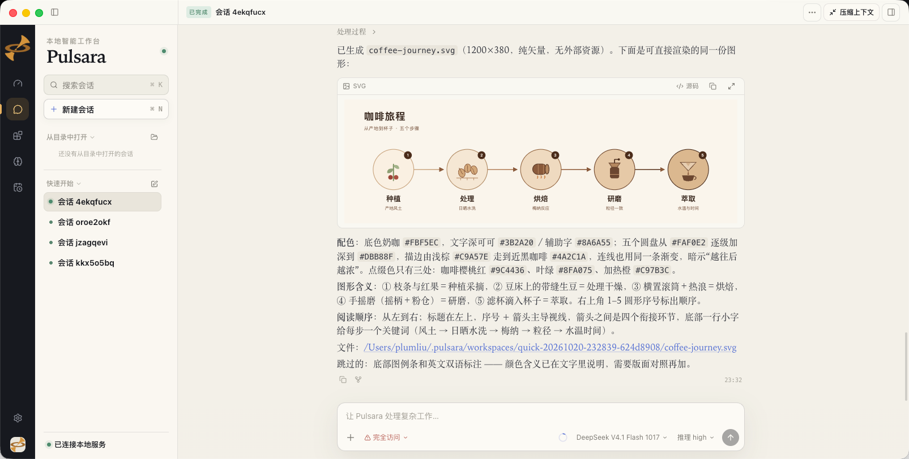
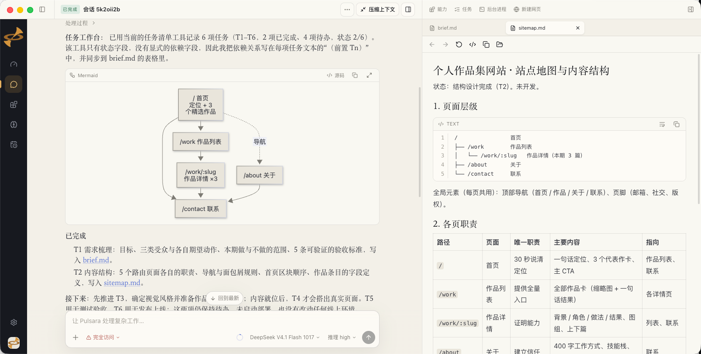

<h1 align="center"> Pulsara</h1>

<strong>Your own team of agents.</strong>

  <a href="https://github.com/plumliu/pulsara-agent/releases/latest">Download</a> &nbsp; | &nbsp;
  <a href="#demo">Watch the demo</a> &nbsp; | &nbsp;
  <a href="INSTALL.md">Installation</a> &nbsp; | &nbsp;
  <a href="README.zh-CN.md">简体中文</a>

## Demo

https://github.com/user-attachments/assets/f78ec29d-f18f-4f9a-b98d-4ce3638ed35f

<table>
  <tr>
    <td width="50%" align="center"><strong>Compare the errors of three methods across different sample sizes, and give me the Python plotting script.</strong></td>
    <td width="50%" align="center"><strong>Design a knowledge base system, sketch its architecture, and outline each component's responsibilities.</strong></td>
  </tr>
  <tr>
    <td></td>
    <td></td>
  </tr>
  <tr>
    <td width="50%" align="center"><strong>Draw a coffee journey infographic from origin to cup, covering growing, processing, roasting, grinding, and brewing.</strong></td>
    <td width="50%" align="center"><strong>Help me plan a portfolio website, with requirements and a sitemap.</strong></td>
  </tr>
  <tr>
    <td></td>
    <td></td>
  </tr>
</table>

## Let a team take on the big jobs!

Have one agent investigate, another compare approaches, and bring in an independent reviewer. Pulsara lets you match models to tasks, and each subagent has its own context. Open the task graph and click into any task to see how it is going.

A solid investigation is worth using again. Follow-up tasks can inherit the conversation and tool history of a completed subtask. Implementation and review start with the same findings, then reach their own conclusions, saving you the trouble of explaining the whole problem again.

> Track down this bug and compare two fixes. Once we pick one, implement it, ask another agent to review it independently, and run the relevant tests.

## Add new requests anytime!

Expand tool calls, background commands, and subagent progress to see what is happening. If a new idea comes to you, pass it to Pulsara right away.

Select part of a reply and annotate it directly. It beats repeatedly explaining which file you meant.

## Pulsara keeps up as the work grows!

Long commands can run in the background while agents move on to other work. Context compaction makes room as the conversation grows, and saved sessions keep a record for your next visit.

Pulsara also takes the cost of long conversations seriously. Stable prompt prefixes let compatible model services reuse input they have already processed. Cache hits can reduce costs and waiting time.

Save preferences, project constraints, and decisions in memory for later tasks to retrieve. You can inspect, edit, or delete them on the memory page.

## Install it and get to work!

[Download the latest desktop release](https://github.com/plumliu/pulsara-agent/releases/latest)

| System | Installer |
| --- | --- |
| macOS 15+, Apple Silicon | [Download DMG](https://github.com/plumliu/pulsara-agent/releases/download/v0.1.0-alpha.2/Pulsara-0.1.0-alpha.2-macos-arm64.dmg) |
| Ubuntu 24.04, amd64 | [Download deb](https://github.com/plumliu/pulsara-agent/releases/download/v0.1.0-alpha.2/Pulsara-0.1.0-alpha.2-linux-amd64.deb) |
| Ubuntu 24.04, arm64 | [Download deb](https://github.com/plumliu/pulsara-agent/releases/download/v0.1.0-alpha.2/Pulsara-0.1.0-alpha.2-linux-arm64.deb) |

1. Install and open Pulsara. Drag the macOS app into Applications, or install the matching Ubuntu deb.
2. Add a model connection in Settings. Choose the provider, model, and API protocol, then follow the prompts for authentication or custom settings.
3. Start a quick session and drop in files, or open a project directory. Give it the job.

This is a desktop preview. See the [installation notes](INSTALL.md) for the first macOS launch, updates, and data locations. The app also includes a `pulsara` command-line entry if you prefer a terminal.

## Try it on your next task

Share what you made and how it went in [Issues](https://github.com/plumliu/pulsara-agent/issues). Feature requests and bug reports are welcome, too. To help build Pulsara, see the [development guide](DEVELOPMENT.md) and [pull requests](https://github.com/plumliu/pulsara-agent/pulls).

If Pulsara helps you, give it a star.
